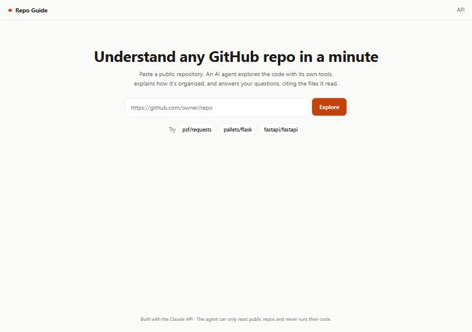
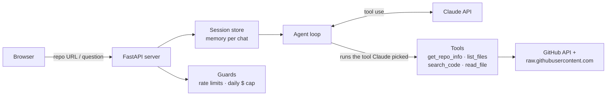

# Repo Guide

[](https://github.com/samgingrich35/Repo-Guide/actions/workflows/ci.yml)

**Paste any public GitHub repo. An AI agent explores the code with its own tools, explains how the project is organized, and answers your questions, citing the files it actually read.**

**▶ Live demo: https://repo-guide-ippc.onrender.com**
_(Free hosting: the first visit after a quiet spell takes ~30–60 s to wake up.)_



## What it does

1. **Paste a repo URL** → the agent explores it and writes an overview: what it is, tech stack, how it's organized, key files to read first, and how to run it.
2. **Ask follow-ups** ("How does routing work?", "Where would I add a new endpoint?"). It remembers the conversation.
3. **Every answer shows its work:** the files it opened (linked to GitHub) and an expandable trace of every tool call, with token count and cost.

It's an **agent**, not a chatbot: Claude decides which tools to call, in what order, and when it knows enough, and says plainly when it couldn't verify something.

## Architecture



**The agent loop** ([app/agent.py](app/agent.py)): send the conversation and tool list to Claude → if it asks for a tool, run it and send the result back → repeat until it answers. A step limit switches tools off and forces an answer, so it can never loop forever.

## How changes reach production

```
git push ─▶ CI (ruff lint · ~70 tests · 80%+ coverage gate · Docker build + smoke test)
              │ only if green
              ▼
           Deploy: build image ─▶ ghcr.io/samgingrich35/repo-guide ─▶ Render deploy hook
                                                                        │
                                                                        ▼
                                              live site  (/health shows the running commit)
```

Nothing reaches production without passing CI, and `/health` reports the exact commit that's live.

## Design decisions

| Decision | Why |
|---|---|
| **Hand-written agent loop** (not a framework) | Full control over the step limit, per-step trace, cost accounting and error handling, and it's easy to explain. |
| **Claude Haiku 5.5 by default** (configurable) | Fast and cheap: an overview costs ~$0.002–0.003. Swap to Opus with one env var. |
| **Prompt caching** on the conversation | Each loop step re-sends the history; cached tokens cost ~90% less. |
| **Tools return capped plain text** | Big repos and files can't blow up the context window or the bill. Errors go back to Claude as results, never crashes. |
| **Raw-content host for file reads** | Found in production: Render's shared IPs exhausted GitHub's 60 req/h anonymous API limit. Reads now bypass it; a read-only token covers the rest. |
| **Per-visitor rate limits + a $1/day global cap** | A public demo link can't drain the API credit, whatever traffic it gets. Blocked requests never reach Claude. |
| **Answers sanitized + strict CSP** | Repo content is untrusted; Markdown is sanitized with DOMPurify and the page only runs its own scripts. |
| **Tests use a fake Claude and fake GitHub** | ~70 tests run offline in seconds, cost nothing, and are deterministic. |
| **Non-root Docker image, same image tested and deployed** | What passed CI is exactly what runs live. |

## How I built this with Claude Code

I built this project with [Claude Code](https://claude.com/claude-code) as my pair programmer, working the way an agentic team would:

- **Plan first.** We wrote a plain-English [ROADMAP.md](ROADMAP.md) of 10 steps, each with a "how you'll know it works" check, and worked through them one at a time.
- **[CLAUDE.md](CLAUDE.md)** gives Claude Code the project's rules: layout, commands, "every feature gets a test", "never commit secrets", "small focused commits".
- **One commit per step**, each verified before moving on: tests, a live run against a real repo, or a check in the browser. The [commit history](https://github.com/samgingrich35/Repo-Guide/commits/main) reads like the build log.
- **I made the product calls:** an agent rather than a chatbot, Haiku for cost, a prepaid budget with no auto-reload, free hosting, and the abuse limits for a public link.
- **Debugging in production:** the GitHub rate-limit issue only appeared on Render. We diagnosed it from the live site, fixed it in code, and added a token. The fix shipped through the same CI/CD pipeline.

## Run it yourself

```bash
python -m venv .venv
.venv/Scripts/pip install -e ".[dev]"      # Windows (use .venv/bin/pip on Mac/Linux)
cp .env.example .env                        # then add your ANTHROPIC_API_KEY
uvicorn app.main:app --reload
```

Open http://localhost:8000 for the app, or http://localhost:8000/docs for the API. Get a key at https://console.anthropic.com/settings/keys. `.env` is git-ignored.

**Terminal chat:** `python -m app.cli https://github.com/pallets/flask`

**Docker:**
```bash
docker build -t repo-guide .
docker run --rm -p 8000:8000 --env-file .env repo-guide
```

**Checks** (same as CI):
```bash
ruff check . && ruff format --check .
pytest --cov=app
```

### API

| Method | Path | What it does |
|---|---|---|
| `POST` | `/api/sessions` | `{"repo_url": "..."}` → starts a chat and returns the overview |
| `POST` | `/api/sessions/{id}/messages` | `{"message": "..."}` → asks a follow-up |
| `GET` | `/health` | Liveness check + running commit |

### Configuration (env vars)

| Variable | Default | Purpose |
|---|---|---|
| `ANTHROPIC_API_KEY` | required | Claude API key |
| `CLAUDE_MODEL` | `claude-haiku-5-5` | Model the agent uses |
| `GITHUB_TOKEN` | optional | Higher GitHub limits + content search (read-only public access is enough) |
| `MAX_AGENT_STEPS` | `10` | Tool calls per question before forcing an answer |
| `NEW_CHATS_PER_HOUR` / `MESSAGES_PER_HOUR` | `10` / `60` | Per-visitor rate limits |
| `DAILY_BUDGET_USD` | `1.00` | Server-wide daily Claude spend cap (`0` = off) |

## Limitations & next steps

- **Sessions live in memory:** a restart or redeploy forgets open chats, and it's one server only. Next: Redis.
- **No streaming yet:** answers appear when finished (a live seconds counter shows progress). Next: stream tool steps and text as they happen.
- **Code search returns file paths without line snippets.** Next: use GitHub's text-match results so the agent can skip a read.
- **Public repos only.** Private repos would need per-user GitHub sign-in.
- **Answer-quality evals:** next, a small eval set of known repos and questions to catch regressions when prompts or models change.

## License

[MIT](LICENSE)
